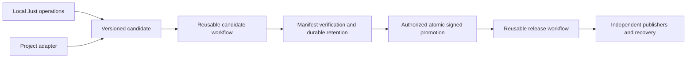

# Release

Define how your project builds. Release handles release candidates,
verification, promotion, and independently recoverable publishing.

[](https://github.com/nbari/release/actions/workflows/ci.yml)

## What Is Release?

Release is a GitHub-native, language-independent release framework. It provides
an optional configuration-validation Action, reusable GitHub workflows, local
Just/Bash operations, and a small project-adapter protocol. Rust, Node.js and
Docker are not runtime requirements of the composite Action.

The Rust CLI [release-flow](https://github.com/nbari/release-flow) is a separate
application. Neither repository needs the other to build or test. Future adoption
by that project will use the same public installation path as any consumer.

## Why Use It?

Build a candidate once, verify its manifest and digests, retain its original
bytes, and promote its exact source commit. Signed tags and retained artifacts
are immutable. Publishers run independently, with durable receipts and locks;
a failed destination can be retried without rebuilding or repeating another one.

## How It Works



The consumer owns source, adapter, configuration and credentials. Release owns
orchestration, identity checks, artifact coordination, retention and publication.
A step Action cannot invoke the complete multi-job release workflow.

## Quick Start

No production distribution has been published from this new repository yet.
Use the clean pinned source installation below. The migration origin and file
ownership are recorded in [MIGRATION_INVENTORY.md](docs/MIGRATION_INVENTORY.md).

Local operations need Git 2.31+, Bash 3.2+, jq 1.6+, Just 1.27+, GitHub CLI and
standard Unix tools. Linux/GNU tar is required for bundle creation and packaging.
Application build tools belong to the adapter.

## GitHub Marketplace Action

The composite **Release Flow Provenance** Action validates configuration and the
declared adapter contract without executing consumer code or mutating refs.
Marketplace publication is intentionally deferred until after migration validation.

```yaml
permissions:
  contents: read
jobs:
  validate:
    runs-on: ubuntu-24.04
    steps:
      - uses: actions/checkout@3d3c42e5aac5ba805825da76410c181273ba90b1
        with:
          persist-credentials: false
      - uses: nbari/release@__MIGRATION_SHA__
        with:
          operation: validate
          adapter: tools/adapter.sh
```

Linux/macOS runners need Bash 3.2+, Git 2.31+ and jq 1.6+. Inputs are `operation`,
`adapter` and `project-directory`; outputs include project, resolved paths,
`runtime-revision` and `validation-json`. See [MARKETPLACE.md](docs/MARKETPLACE.md).

## Reusable Workflows

Use these at the job level. The installer generates complete thin callers
pinned to the same source SHA as the installed local bundle:

```yaml
name: Candidate
on:
  push:
    branches: ['release/**']
permissions:
  contents: read
jobs:
  candidate:
    uses: nbari/release/.github/workflows/candidate.yml@__MIGRATION_SHA__
    with:
      adapter: tools/adapter.sh
    permissions:
      contents: write
      id-token: write
```

The canonical publisher is
`nbari/release/.github/workflows/release.yml@__MIGRATION_SHA__`.
[Complete callers](docs/ADOPTION.md#reusable-workflows) include tag triggers and
per-channel dispatch inputs. Candidate builds receive no publisher secrets.
Only retention obtains storage write access. Unconfigured channels are skipped;
unknown or explicitly unconfigured selections fail closed.

## Project Adapters

Implement six commands in an executable file inside your project:

| Command | Purpose |
| --- | --- |
| `version` | Print the current X.Y.Z version. |
| `set-version X.Y.Z` | Update version files and print the changed paths. |
| `verify` | Run your project checks. |
| `targets` | Declare build targets and runner labels as JSON. |
| `inventory X.Y.Z` | Declare every artifact name and target as JSON. |
| `package X.Y.Z OUTDIR` | Produce exactly those artifacts in an empty directory. |

See the complete [shell application](examples/shell/README.md) and
[protocol](docs/ADOPTION.md#adapter-protocol-v1). The optional Cargo adapter supports
Rust projects; the framework itself has no Cargo project or Rust application.

## Preparing Release Candidates

After installing the bundle and completing repository setup:

```bash
git switch develop
just deploy                    # patch; source branch stays unchanged
# just deploy-minor
# just deploy-major
just release-candidates
just release-status X.Y.Z --json
```

Preparation creates `release/X.Y.Z-<base12>` with a version-bump commit. On the
test base it creates `release/test/...`, which cannot be promoted. CI tests the
exact source, packages targets, verifies manifest/checksums and retains production
candidate bytes. See [branch lifecycle](docs/BRANCHES.md).

## Promoting Releases

An authorized operator reviews CI and retention, then runs:

```bash
just release-promote release/X.Y.Z-<base12> <candidate-sha> --dry-run
just release-promote release/X.Y.Z-<base12> <candidate-sha>
```

The guarded process atomically advances main/develop and creates the signed
immutable tag. Existing local or forwarded SSH keys can authenticate and sign;
no separate deploy key is required by the default administrator authorization.
Configure [rulesets](docs/RULESETS.md) before the first promotion.

## Publishing and Recovery

```bash
just release-status X.Y.Z --json
just release-retry X.Y.Z github-release
just release-prune --dry-run
```

Publishers reuse verified retained bytes. Fix failed/stale candidates on their
base and prepare a fresh one; retry publication independently for the original
signed version. Status, plan and default cleanup are read-only. Cleanup never
removes signed tags, release assets or ledger evidence. See
[candidate management](docs/CANDIDATES.md).

GitHub-only storage uses immutable releases plus a separate protected metadata
branch. S3 and filesystem stores remain supported. See
[GITHUB_STORAGE.md](docs/GITHUB_STORAGE.md) and [release design](docs/RELEASE_DESIGN.md).

## Installation and Upgrades

Start in your consumer repository. Build the versioned bundle from a clean,
reviewed source commit; no release-flow binary or Cargo project is needed:

```bash
RF_TARGET="$(pwd)"
RF_SOURCE="$(mktemp -d)"
RF_OUT="$(mktemp -d)"
RF_SHA=__MIGRATION_SHA__
git clone https://github.com/nbari/release.git "$RF_SOURCE/source"
git -C "$RF_SOURCE/source" checkout --detach "$RF_SHA"
test -z "$(git -C "$RF_SOURCE/source" status --porcelain)"
RF_VERSION="$(cat "$RF_SOURCE/source/VERSION")"
bash "$RF_SOURCE/source/scripts/release-flow-bundle.sh" \
  --version "$RF_VERSION" --out "$RF_OUT" --workflow-mode reusable
tar -xzf "$RF_OUT/release-flow-bundle-$RF_VERSION.tar.gz" -C "$RF_OUT"
RF_BUNDLE="$RF_OUT/release-flow-bundle-$RF_VERSION"
bash "$RF_BUNDLE/install.sh" --target "$RF_TARGET"
```

Your root Justfile needs `import '.justfiles/deploy.just'`. Add your config and
adapter using the [full adoption guide](docs/ADOPTION.md). The installer checks
checksums, rejects symlinks/conflicts and records managed ownership. Use
`install.sh --target . --check` for drift and `--upgrade` for reviewed upgrades.
Align the Action, callers and configuration pipeline SHA with the bundle source.

The existing `release-flow-bundle-*` artifact naming and `.release-flow.json`
configuration remain compatible. After a first production release exists,
[verified published-bundle installation](docs/ADOPTION.md#a-download-a-published-verified-bundle)
will also be available. No nonexistent download URL is advertised here.

## Examples

- [Complete shell consumer](examples/shell/README.md), requiring no Rust or Docker.
- [Generic Cargo adapter](scripts/adapters/cargo.sh), installed only on request.
- [Framework self-adapter](scripts/adapters/framework.sh), using VERSION and packaging only its bundle.

## Security

Pin every Action/workflow to a full SHA. Trusted runtime revision must equal the
called workflow revision; consumer source SHA is independent. Never execute
untrusted adapters with publisher credentials or use privileged PR triggers.
Preserve exact-SHA validation, signatures, manifests, digest verification, CAS
writes, locks and idempotent channel receipts. Storage records are data only.

## Documentation

[Adoption](docs/ADOPTION.md) · [Marketplace](docs/MARKETPLACE.md) ·
[Design](docs/RELEASE_DESIGN.md) · [Rulesets](docs/RULESETS.md) ·
[Branches](docs/BRANCHES.md) · [Migration](docs/MIGRATION_INVENTORY.md)

For development, install `tests/requirements.txt` in a Python virtual environment.
`just check` and `just pipeline-test` run core tests with application toolchains
blocked. `just cargo-adapter-test` is optional and builds an isolated Cargo fixture.
The composite Action does not require Python/PyYAML. BSD-3-Clause licensed.
